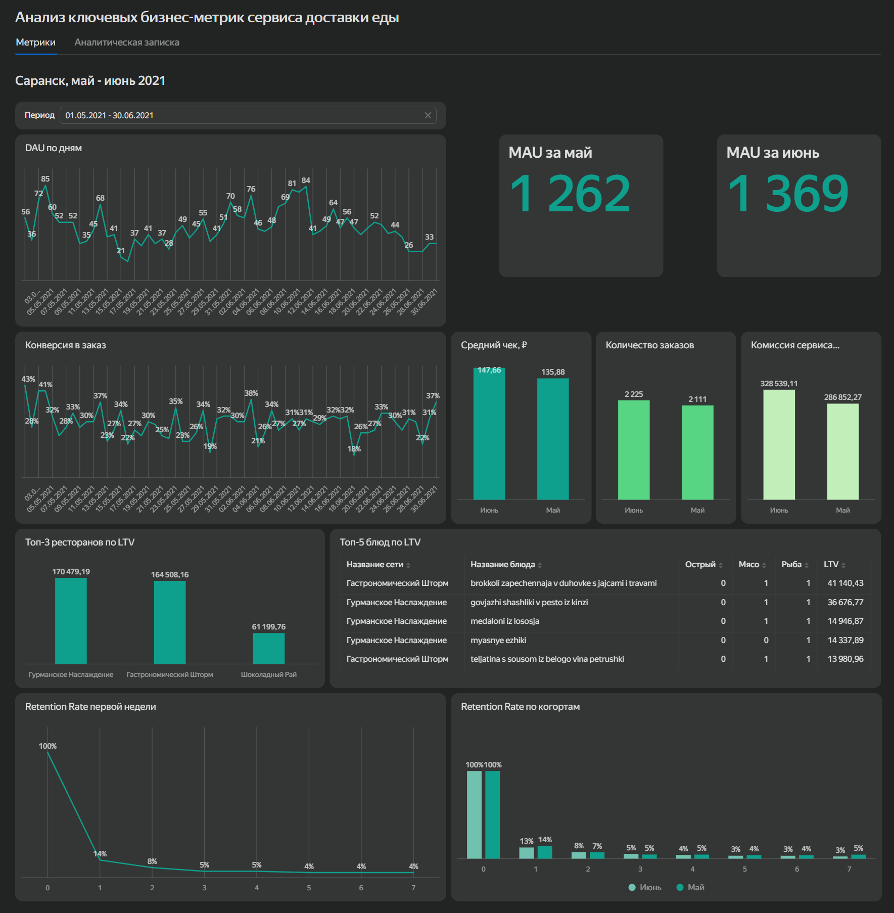

# Анализ ключевых бизнес-метрик сервиса доставки еды

Анализ основных бизнес-метрик сервиса доставки еды «Все.из.кафе» в Саранске за май-июнь 2021 года. В проекте исследованы активность и удержание пользователей, конверсия в заказ, показатели монетизации и LTV ресторанов и блюд. Для работы с основными показателями также подготовлен интерактивный дашборд в Yandex DataLens.

## Цель проекта

Проанализировать ключевые показатели сервиса доставки еды, оценить изменение пользовательской активности и монетизации, изучить удержание пользователей и определить рестораны и блюда с наибольшим LTV.

## Инструменты

- PostgreSQL
- DBeaver
- Yandex DataLens

## Что сделано

- рассчитаны DAU и MAU для оценки активности пользователей;
- изучена динамика конверсии пользователей в заказ;
- рассчитаны количество заказов, комиссия сервиса и средний чек;
- определены рестораны и блюда с наибольшим LTV;
- рассчитан Retention Rate первой недели и проведено сравнение майской и июньской когорт;
- разработан интерактивный дашборд с основными бизнес-метриками сервиса.

## Основные результаты

- MAU вырос с 1 262 пользователей в мае до 1 369 в июне, или на 8,5%.
- В июне количество заказов выросло на 5,4%, средний чек - на 8,7%, а комиссия сервиса - на 14,5%.
- Конверсия в заказ заметно менялась по дням и не показывала устойчивого роста или снижения.
- На следующий день после первого посещения в сервис возвращаются 14% пользователей, а к седьмому дню Retention Rate снижается до 4%.
- Наибольший LTV среди ресторанов показали «Гурманское Наслаждение» и «Гастрономический Шторм».

## Дашборд

Интерактивный дашборд позволяет отслеживать пользовательскую активность и конверсию, сравнивать показатели монетизации, анализировать LTV ресторанов и блюд и оценивать удержание пользователей.

[Открыть дашборд в Yandex DataLens](https://datalens.yandex/s6mlyj0cpkr2d?_share_link=public)

## Файлы проекта

- [`food_delivery_metrics_analysis.md`](food_delivery_metrics_analysis.md) - полный ход исследования, SQL-запросы, результаты и выводы
- [`food_delivery_metrics.sql`](food_delivery_metrics.sql) - SQL-запросы проекта
- [`dashboard_images/`](dashboard_images/) - скриншоты дашборда