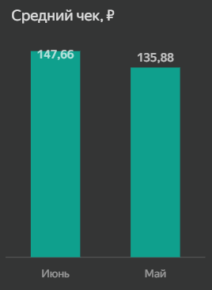

# Анализ ключевых бизнес-метрик сервиса доставки еды

Сервис доставки еды «Все.из.кафе» работает с ресторанами-партнерами и получает комиссию с каждого заказа. В рамках проекта проведен анализ основных бизнес-метрик сервиса в Саранске за май-июнь 2021 года.

Цель анализа - оценить активность и удержание пользователей, конверсию в заказ, показатели монетизации, а также определить рестораны и блюда с наибольшим LTV.

## 1. Активность пользователей

### 1.1. DAU

Для оценки ежедневной активности рассчитаем количество уникальных пользователей, совершивших хотя бы один заказ в течение дня.

```sql
SELECT
    events.log_date AS date,
    COUNT(DISTINCT events.user_id) AS dau
FROM rest_analytics.analytics_events AS events
JOIN rest_analytics.cities AS cities
    ON events.city_id = cities.city_id
WHERE events.log_date BETWEEN '2021-05-01' AND '2021-06-30'
    AND cities.city_name = 'Саранск'
    AND events.event = 'order'
GROUP BY events.log_date
ORDER BY events.log_date;
```

Результат запроса:

| Дата | DAU |
|---|---:|
| 2021-05-01 | 56 |
| 2021-05-02 | 36 |
| 2021-05-03 | 72 |
| 2021-05-04 | 85 |
| 2021-05-05 | 60 |
| ... | ... |
| 2021-06-26 | 26 |
| 2021-06-27 | 26 |
| 2021-06-28 | 26 |
| 2021-06-29 | 33 |
| 2021-06-30 | 33 |


DAU заметно менялся в течение двух месяцев. Максимальное значение зафиксировано 4 мая - 85 пользователей. Еще один период высокой активности наблюдался 9-11 июня, когда DAU составлял 79-84 пользователя. После этого показатель начал снижаться, а в последние пять дней июня находился на уровне 26-33 пользователей.

### 1.2. MAU

Для сравнения месячной активности рассчитаем количество уникальных пользователей, совершивших хотя бы один заказ в течение месяца.

```sql
SELECT
    DATE_TRUNC('month', events.log_date)::date AS month,
    COUNT(DISTINCT events.user_id) AS mau
FROM rest_analytics.analytics_events AS events
JOIN rest_analytics.cities AS cities
    ON events.city_id = cities.city_id
WHERE events.log_date BETWEEN '2021-05-01' AND '2021-06-30'
    AND cities.city_name = 'Саранск'
    AND events.event = 'order'
GROUP BY DATE_TRUNC('month', events.log_date)
ORDER BY month;
```

Результат запроса:

| Месяц | MAU |
|---|---:|
| Май | 1 262 |
| Июнь | 1 369 |


В июне MAU составил 1 369 пользователей против 1 262 в мае, рост составил около 8,5%. При этом рост месячной аудитории не означает равномерного увеличения ежедневной активности: во второй половине июня DAU снижался, несмотря на более высокий MAU по итогам месяца.

## 2. Конверсия в заказ

Рассчитаем долю уникальных пользователей, которые совершили заказ, среди всех пользователей сервиса за каждый день.

```sql
SELECT
    events.log_date AS date,
    ROUND(
        COUNT(DISTINCT events.user_id)
            FILTER (WHERE events.event = 'order')
        / COUNT(DISTINCT events.user_id)::numeric,
        2
    ) AS conversion_rate
FROM rest_analytics.analytics_events AS events
JOIN rest_analytics.cities AS cities
    ON events.city_id = cities.city_id
WHERE events.log_date BETWEEN '2021-05-01' AND '2021-06-30'
    AND cities.city_name = 'Саранск'
GROUP BY events.log_date
ORDER BY events.log_date;
```

Результат запроса:

| Дата | Conversion Rate |
|---|---:|
| 2021-05-01 | 43% |
| 2021-05-02 | 28% |
| 2021-05-03 | 41% |
| 2021-05-04 | 41% |
| 2021-05-05 | 32% |
| ... | ... |
| 2021-06-26 | 31% |
| 2021-06-27 | 30% |
| 2021-06-28 | 22% |
| 2021-06-29 | 31% |
| 2021-06-30 | 37% |


Конверсия заметно колебалась по дням без устойчивого роста или снижения. Максимальное значение за период составило 43% 1 мая, минимальное - 18% 18 июня. В конце июня после снижения до 22% 28 июня показатель восстановился до 37% к последнему дню месяца.

## 3. Монетизация

Для оценки монетизации сравним количество заказов, общую комиссию сервиса и среднюю комиссию с одного заказа в мае и июне.

```sql
WITH orders AS (
    SELECT
        events.log_date,
        events.order_id,
        events.revenue * events.commission AS commission_revenue
    FROM rest_analytics.analytics_events AS events
    JOIN rest_analytics.cities AS cities
        ON events.city_id = cities.city_id
    WHERE events.revenue IS NOT NULL
        AND events.log_date BETWEEN '2021-05-01' AND '2021-06-30'
        AND cities.city_name = 'Саранск'
)

SELECT
    DATE_TRUNC('month', log_date)::date AS month,
    COUNT(DISTINCT order_id) AS orders_count,
    ROUND(SUM(commission_revenue)::numeric, 2) AS total_commission,
    ROUND(
        (SUM(commission_revenue) / COUNT(DISTINCT order_id))::numeric,
        2
    ) AS avg_check
FROM orders
GROUP BY DATE_TRUNC('month', log_date)
ORDER BY month;
```

Результат запроса:

| Месяц | Количество заказов | Комиссия сервиса, руб. | Средний чек, руб. |
|---|---:|---:|---:|
| Май | 2 111 | 286 852,27 | 135,88 |
| Июнь | 2 225 | 328 539,11 | 147,66 |




В июне выросли все три показателя. Количество заказов увеличилось с 2 111 до 2 225, или на 5,4%, а средний чек - со 135,88 до 147,66 руб., или на 8,7%. За счет одновременного роста количества заказов и среднего чека комиссия сервиса увеличилась сильнее - с 286,9 до 328,5 тыс. руб., примерно на 14,5%.

## 4. LTV ресторанов и блюд

### 4.1. Топ-3 ресторанов по LTV

В рамках проекта LTV ресторана рассчитывается как общая комиссия сервиса от его заказов за рассматриваемый период. Определим три ресторана с наибольшим значением показателя.

```sql
WITH orders AS (
    SELECT
        events.rest_id,
        events.city_id,
        events.revenue * events.commission AS commission_revenue
    FROM rest_analytics.analytics_events AS events
    JOIN rest_analytics.cities AS cities
        ON events.city_id = cities.city_id
    WHERE events.revenue IS NOT NULL
        AND events.log_date BETWEEN '2021-05-01' AND '2021-06-30'
        AND cities.city_name = 'Саранск'
)

SELECT
    orders.rest_id,
    partners.chain AS restaurant_name,
    partners.type AS restaurant_type,
    ROUND(SUM(orders.commission_revenue)::numeric, 2) AS ltv
FROM orders
JOIN rest_analytics.partners AS partners
    ON orders.rest_id = partners.rest_id
    AND orders.city_id = partners.city_id
GROUP BY
    orders.rest_id,
    partners.chain,
    partners.type
ORDER BY ltv DESC
LIMIT 3;
```

Результат запроса:

| Ресторан | Тип | LTV, руб. |
|---|---|---:|
| Гурманское Наслаждение | Ресторан | 170 479,19 |
| Гастрономический Шторм | Ресторан | 164 508,16 |
| Шоколадный Рай | Кондитерская | 61 199,76 |


Наибольший LTV у «Гурманского Наслаждения» - 170,5 тыс. руб., немного ниже показатель у «Гастрономического Шторма» - 164,5 тыс. руб. «Шоколадный Рай» занимает третье место с 61,2 тыс. руб., что заметно ниже результатов двух лидеров.

### 4.2. Топ-5 блюд по LTV

Для двух ресторанов с наибольшим LTV определим пять блюд, которые принесли сервису наибольшую комиссию.

```sql
WITH orders AS (
    SELECT
        events.rest_id,
        events.city_id,
        events.object_id,
        events.revenue * events.commission AS commission_revenue
    FROM rest_analytics.analytics_events AS events
    JOIN rest_analytics.cities AS cities
        ON events.city_id = cities.city_id
    WHERE events.revenue IS NOT NULL
        AND events.log_date BETWEEN '2021-05-01' AND '2021-06-30'
        AND cities.city_name = 'Саранск'
),

top_ltv_restaurants AS (
    SELECT
        orders.rest_id,
        partners.chain,
        partners.type,
        SUM(orders.commission_revenue) AS ltv
    FROM orders
    JOIN rest_analytics.partners AS partners
        ON orders.rest_id = partners.rest_id
        AND orders.city_id = partners.city_id
    GROUP BY
        orders.rest_id,
        partners.chain,
        partners.type
    ORDER BY ltv DESC
    LIMIT 2
)

SELECT
    top_ltv_restaurants.chain AS restaurant_name,
    dishes.name AS dish_name,
    dishes.spicy,
    dishes.fish,
    dishes.meat,
    ROUND(SUM(orders.commission_revenue)::numeric, 2) AS ltv
FROM orders
JOIN top_ltv_restaurants
    ON orders.rest_id = top_ltv_restaurants.rest_id
JOIN rest_analytics.dishes AS dishes
    ON orders.object_id = dishes.object_id
    AND orders.rest_id = dishes.rest_id
GROUP BY
    top_ltv_restaurants.chain,
    dishes.name,
    dishes.spicy,
    dishes.fish,
    dishes.meat
ORDER BY ltv DESC
LIMIT 5;
```

Результат запроса:

| Ресторан | Блюдо | Острое | Рыба | Мясо | LTV, руб. |
|---|---|---:|---:|---:|---:|
| Гастрономический Шторм | brokkoli zapechennaja v duhovke s jajcami i travami | 0 | 1 | 1 | 41 140,43 |
| Гурманское Наслаждение | govjazhi shashliki v pesto iz kinzi | 0 | 1 | 1 | 36 676,77 |
| Гурманское Наслаждение | medaloni iz lososja | 0 | 1 | 1 | 14 946,87 |
| Гурманское Наслаждение | myasnye ezhiki | 0 | 0 | 1 | 14 337,89 |
| Гастрономический Шторм | teljatina s sousom iz belogo vina petrushki | 0 | 1 | 1 | 13 980,96 |


Лидером среди блюд стала запеченная брокколи из «Гастрономического Шторма» с LTV 41,1 тыс. руб., на втором месте - говяжьи шашлыки из «Гурманского Наслаждения» с 36,7 тыс. руб. Три из пяти позиций относятся к «Гурманскому Наслаждению». У всех пяти блюд отсутствует признак острого блюда, а у четырех одновременно указаны признаки рыбы и мяса.

## 5. Удержание пользователей

### 5.1. Retention Rate первой недели

Рассчитаем долю новых пользователей, которые возвращались в сервис в течение первых семи дней после первого посещения.

```sql
WITH new_users AS (
    SELECT DISTINCT
        events.first_date,
        events.user_id
    FROM rest_analytics.analytics_events AS events
    JOIN rest_analytics.cities AS cities
        ON events.city_id = cities.city_id
    WHERE events.first_date BETWEEN '2021-05-01' AND '2021-06-24'
        AND cities.city_name = 'Саранск'
),

active_users AS (
    SELECT DISTINCT
        events.log_date,
        events.user_id
    FROM rest_analytics.analytics_events AS events
    JOIN rest_analytics.cities AS cities
        ON events.city_id = cities.city_id
    WHERE events.log_date BETWEEN '2021-05-01' AND '2021-06-30'
        AND cities.city_name = 'Саранск'
),

daily_retention AS (
    SELECT
        new_users.user_id,
        new_users.first_date,
        active_users.log_date::date - new_users.first_date::date
            AS day_since_first_visit
    FROM new_users
    JOIN active_users
        ON new_users.user_id = active_users.user_id
        AND active_users.log_date >= new_users.first_date
)

SELECT
    day_since_first_visit,
    COUNT(DISTINCT user_id) AS retained_users,
    ROUND(
        COUNT(DISTINCT user_id)::numeric
        / MAX(COUNT(DISTINCT user_id)) OVER (),
        2
    ) AS retention_rate
FROM daily_retention
WHERE day_since_first_visit BETWEEN 0 AND 7
GROUP BY day_since_first_visit
ORDER BY day_since_first_visit;
```

Результат запроса:

| День после первого посещения | Пользователи | Retention Rate |
|---:|---:|---:|
| 0 | 5 572 | 100% |
| 1 | 768 | 14% |
| 2 | 419 | 8% |
| 3 | 283 | 5% |
| 4 | 251 | 5% |
| 5 | 207 | 4% |
| 6 | 205 | 4% |
| 7 | 205 | 4% |


Основное снижение происходит сразу после первого посещения: на следующий день возвращаются 14% пользователей, а на второй день - 8%. К третьему дню Retention Rate снижается до 5%, после чего меняется уже незначительно и к седьмому дню составляет 4%.

### 5.2. Retention Rate по месячным когортам

Сравним удержание пользователей, впервые посетивших сервис в мае и июне.

```sql
WITH new_users AS (
    SELECT DISTINCT
        events.first_date,
        events.user_id
    FROM rest_analytics.analytics_events AS events
    JOIN rest_analytics.cities AS cities
        ON events.city_id = cities.city_id
    WHERE events.first_date BETWEEN '2021-05-01' AND '2021-06-24'
        AND cities.city_name = 'Саранск'
),

active_users AS (
    SELECT DISTINCT
        events.log_date,
        events.user_id
    FROM rest_analytics.analytics_events AS events
    JOIN rest_analytics.cities AS cities
        ON events.city_id = cities.city_id
    WHERE events.log_date BETWEEN '2021-05-01' AND '2021-06-30'
        AND cities.city_name = 'Саранск'
),

daily_retention AS (
    SELECT
        new_users.user_id,
        new_users.first_date,
        active_users.log_date::date - new_users.first_date::date
            AS day_since_first_visit
    FROM new_users
    JOIN active_users
        ON new_users.user_id = active_users.user_id
        AND active_users.log_date >= new_users.first_date
),

cohort_retention AS (
    SELECT
        DATE_TRUNC('month', first_date)::date AS cohort_month,
        day_since_first_visit,
        COUNT(DISTINCT user_id) AS retained_users
    FROM daily_retention
    WHERE day_since_first_visit BETWEEN 0 AND 7
    GROUP BY
        DATE_TRUNC('month', first_date),
        day_since_first_visit
)

SELECT
    cohort_month,
    day_since_first_visit,
    retained_users,
    ROUND(
        retained_users::numeric
        / FIRST_VALUE(retained_users) OVER (
            PARTITION BY cohort_month
            ORDER BY day_since_first_visit
        ),
        2
    ) AS retention_rate
FROM cohort_retention
ORDER BY
    cohort_month,
    day_since_first_visit;
```

Результат запроса:

| Когорта | День | Пользователи | Retention Rate |
|---|---:|---:|---:|
| Май | 0 | 3 069 | 100% |
| Май | 1 | 443 | 14% |
| Май | 2 | 223 | 7% |
| Май | 3 | 144 | 5% |
| Май | 4 | 142 | 5% |
| Май | 5 | 122 | 4% |
| Май | 6 | 120 | 4% |
| Май | 7 | 140 | 5% |
| Июнь | 0 | 2 576 | 100% |
| Июнь | 1 | 328 | 13% |
| Июнь | 2 | 196 | 8% |
| Июнь | 3 | 140 | 5% |
| Июнь | 4 | 109 | 4% |
| Июнь | 5 | 86 | 3% |
| Июнь | 6 | 85 | 3% |
| Июнь | 7 | 65 | 3% |


В первые дни показатели двух когорт близки: на следующий день возвращаются 14% пользователей майской когорты и 13% июньской, на второй день - 7% и 8% соответственно. Дальше майская когорта удерживается немного лучше: на седьмой день Retention Rate составляет 5% против 3% у июньской. В обеих когортах основная потеря пользователей происходит в первые два дня.

## 6. Итоговые выводы и рекомендации

В июне месячная аудитория сервиса выросла на 8,5%, а количество заказов - на 5,4%. Одновременно увеличились средний чек и комиссия сервиса, которая достигла 328,5 тыс. руб. против 286,9 тыс. руб. в мае. При этом ежедневная активность оставалась нестабильной: после высоких значений в первой половине июня DAU заметно снизился к концу месяца. Конверсия в заказ также сильно менялась по дням и не показывала устойчивого роста.

Основная проблема заметна в удержании пользователей. Уже на следующий день после первого посещения в сервис возвращаются только 14% пользователей, а к седьмому дню Retention Rate снижается до 4%. У майской когорты удержание к концу первой недели немного выше, чем у июньской: 5% против 3%.

Наибольший LTV среди ресторанов показали «Гурманское Наслаждение» и «Гастрономический Шторм». Их показатели значительно выше результата ресторана на третьем месте, поэтому эти партнеры особенно важны для текущей выручки сервиса. Среди блюд также выделяются несколько позиций с высоким LTV, которые можно использовать при продвижении внутри приложения.

В первую очередь стоит обратить внимание на удержание новых пользователей в первые дни после знакомства с сервисом. Для этого можно тестировать предложения на повторный заказ и персональные рекомендации. Отдельно стоит следить за снижением DAU в конце июня и проверить, сохраняется ли эта динамика в следующих периодах. При продвижении ресторанов и блюд можно учитывать LTV и давать дополнительную видимость наиболее прибыльным позициям, но при этом важно не создавать слишком сильную зависимость от нескольких партнеров.