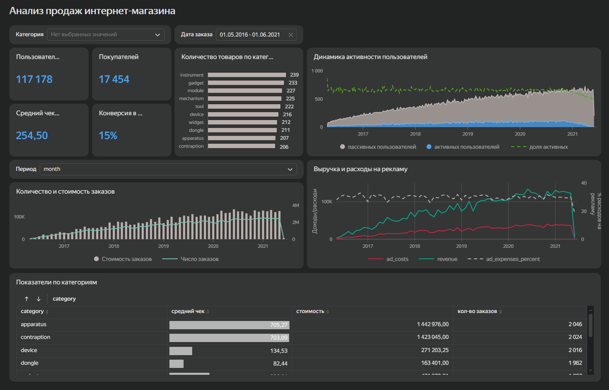

# Анализ ключевых метрик интернет-магазина

Интерактивный дашборд для анализа основных показателей интернет-магазина. В проекте рассмотрены продажи, пользовательская активность, конверсия в покупку и рекламные расходы. Дашборд позволяет отслеживать изменение показателей во времени и анализировать их в разрезе товарных категорий.

## Цель проекта

Разработать интерактивный дашборд для анализа ключевых показателей интернет-магазина и оценки динамики продаж, пользовательской активности и рекламных расходов.

## Инструменты

- Yandex DataLens

## Что сделано

- рассчитаны основные показатели пользовательской активности и продаж;
- проанализированы количество пользователей и покупателей, средний чек и конверсия в покупку;
- построена динамика активных и неактивных пользователей;
- проанализированы количество и стоимость заказов;
- сопоставлены выручка и расходы на рекламу;
- проведено сравнение показателей по товарным категориям;
- добавлены фильтры по периоду и категориям для интерактивного анализа данных.

## Основные возможности дашборда

- мониторинг ключевых показателей интернет-магазина;
- анализ динамики пользовательской активности;
- сравнение товарных категорий;
- анализ количества и стоимости заказов;
- отслеживание выручки и рекламных расходов;
- изменение периода и детализации анализа с помощью фильтров.

## Дашборд

Интерактивный дашборд позволяет анализировать показатели интернет-магазина в динамике и изучать отдельные категории товаров с помощью фильтров.

[Открыть дашборд в Yandex DataLens](https://datalens.yandex/e48kp5t0nboqz?_share_link=public)

## Файлы проекта

- [`dashboard_images/`](dashboard_images/) - скриншоты дашборда