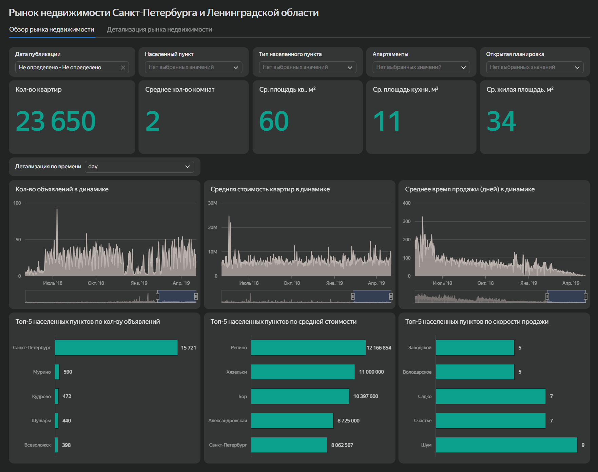
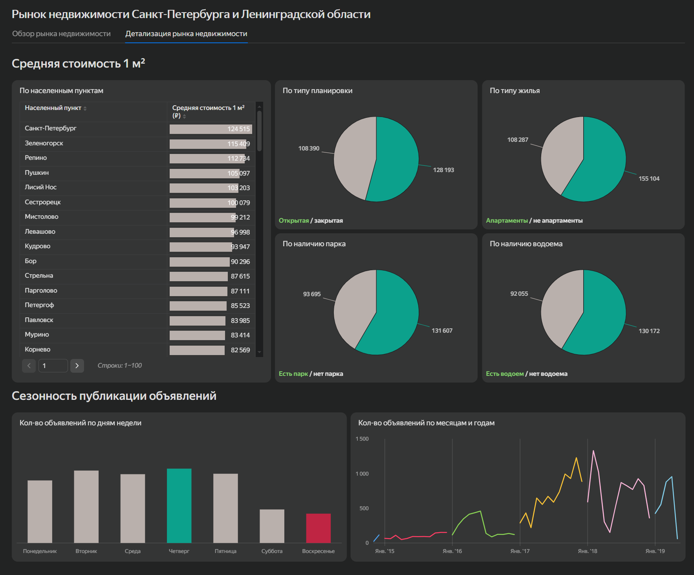

# Анализ рынка недвижимости Санкт-Петербурга и Ленинградской области

Анализ рынка жилой недвижимости для агентства, которое рассматривает выход в Санкт-Петербург и Ленинградскую область. В проекте исследованы время активности объявлений, сезонность рынка и различия между отдельными населенными пунктами. Для работы с основными показателями также подготовлен интерактивный дашборд в Yandex DataLens.

## Цель проекта

Изучить рынок жилой недвижимости, определить особенности объявлений с разным сроком активности, найти сезонные изменения и сравнить показатели отдельных территорий.

## Инструменты

- PostgreSQL
- DBeaver
- Yandex DataLens

## Что сделано

- проведена фильтрация аномальных значений в характеристиках недвижимости;
- объявления разделены по времени активности и проведено сравнение Санкт-Петербурга с городами Ленинградской области;
- изучена сезонность публикации и снятия объявлений;
- проведен дополнительный анализ 15 населенных пунктов с наибольшим количеством снятых объявлений;
- разработан интерактивный дашборд для анализа рынка и отдельных сегментов недвижимости.

## Основные результаты

- В Санкт-Петербурге 31% объявлений остаются активными более 180 дней, еще 27% снимаются через 31-90 дней.
- Более быстро снимаемые объявления в Санкт-Петербурге в среднем относятся к менее крупным и более дешевым объектам.
- Наибольшее количество новых объявлений публикуется в ноябре, а максимум снятий приходится на октябрь.
- Среди 15 рассмотренных населенных пунктов самое низкое среднее время активности объявлений у Колпино, Мурино и Шушар.
- Средняя стоимость квадратного метра среди этих населенных пунктов наиболее высокая в Пушкине и Сестрорецке.

## Дашборд

Интерактивный дашборд позволяет фильтровать данные по характеристикам недвижимости, анализировать динамику основных показателей и сравнивать отдельные сегменты рынка.

[Открыть дашборд в Yandex DataLens](https://datalens.yandex/sklmlpx1jh5qd?_share_link=public)

## Файлы проекта

- [`real_estate_market_analysis.md`](real_estate_market_analysis.md) - полный ход исследования, SQL-запросы, результаты и выводы
- [`real_estate_market_analysis.sql`](real_estate_market_analysis.sql) - SQL-запросы проекта
- [`dashboard_images/`](dashboard_images/) - скриншоты дашборда