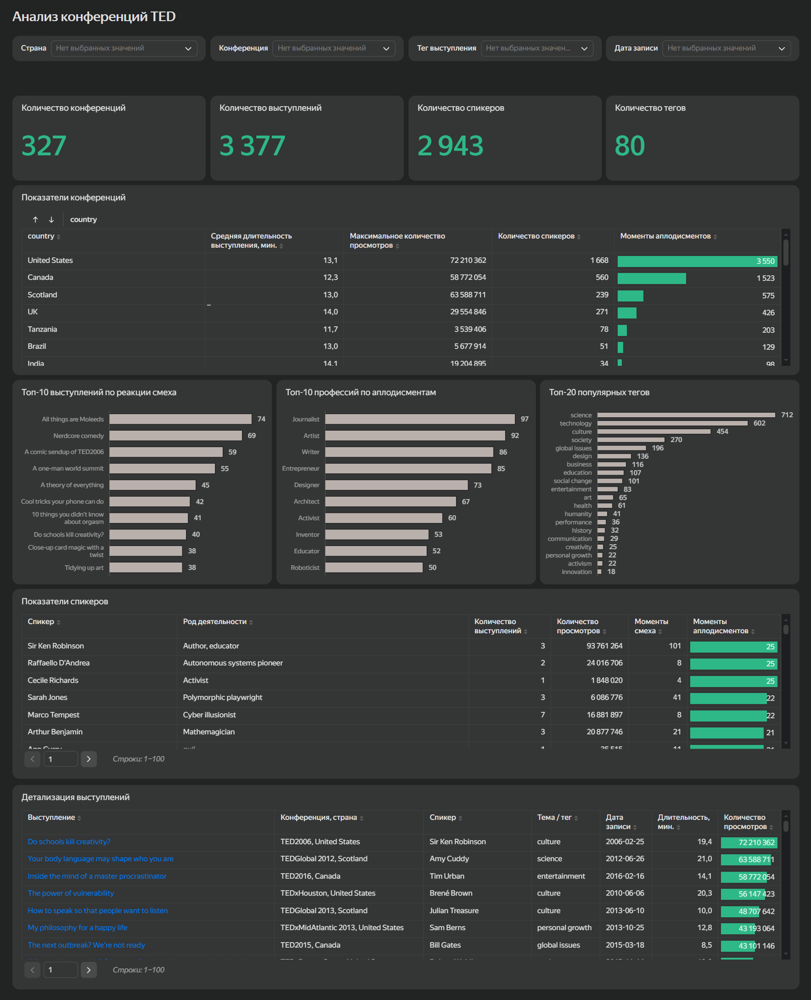

# Анализ конференций TED

Интерактивный дашборд для компании, которая планирует проведение конференции TED и хочет использовать опыт предыдущих мероприятий при выборе тем, спикеров и формата конференции. В проекте проанализированы конференции, выступления, популярные темы и реакции аудитории.

## Цель проекта

Разработать интерактивный дашборд, который поможет изучить опыт проведенных конференций TED, определить популярные темы и выступления, а также сравнить показатели конференций и спикеров.

## Инструменты

- Yandex DataLens

## Что сделано

- подготовлены основные показатели по конференциям, выступлениям, спикерам и темам;
- реализовано сравнение конференций по странам, длительности выступлений, просмотрам и реакции аудитории;
- определены наиболее популярные темы и выступления с наибольшим количеством реакций смеха;
- проведено сравнение профессий спикеров по количеству аплодисментов;
- добавлена детализация по отдельным спикерам и выступлениям;
- настроены фильтры по стране, конференции, тегу выступления и дате записи.

## Основные результаты

- В данных представлено 327 конференций, 3 377 выступлений и 2 943 спикера.
- Наибольшее количество спикеров представлено на конференциях в США.
- Самые распространенные теги выступлений - science, technology и culture.
- Среди рассмотренных выступлений максимальное количество просмотров превышает 72 млн.
- Дашборд позволяет детально изучать отдельные конференции, спикеров и выступления с помощью интерактивных фильтров.

## Дашборд

Интерактивный дашборд позволяет фильтровать данные по стране, конференции, тегу и дате записи, сравнивать показатели конференций и спикеров и переходить к отдельным выступлениям.

[Открыть дашборд в Yandex DataLens](https://datalens.yandex/h7wbh5ykgiv42?_share_link=public)

## Файлы проекта

[`dashboard_images/`](dashboard_images/ted_conferences_dashboard.png) - скриншот дашборда